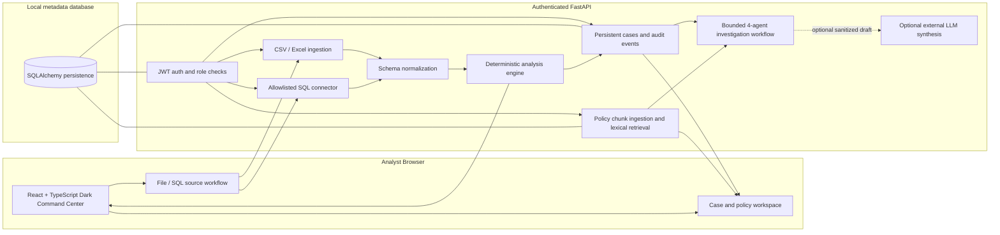

# SentinelAML Architecture

## Logical component diagram



## Repository structure

```text
SentinelAML/
├── README.md
├── docs/                         # Product, architecture, ERD, security, rules, API and roadmap
├── backend/
│   ├── app/
│   │   ├── main.py               # FastAPI auth, ingestion, cases, policies and audit routes
│   │   ├── persistence.py        # SQLAlchemy models, password hashing and JWT utilities
│   │   ├── ingestion.py          # CSV/Excel input validation and schema inference
│   │   ├── sql_sources.py        # Read-only allowlisted SQL adapters
│   │   ├── analysis.py           # Canonical normalization and explainable heuristics
│   │   ├── policy_service.py     # Approved policy text extraction/chunking/search
│   │   └── investigation_agents.py
│   ├── tests/
│   └── requirements.txt
├── frontend/
│   └── src/                      # React/TypeScript UI and dashboard styles
└── .github/workflows/ci.yml
```

## Runtime responsibilities

### Browser
- Presents the Power BI-inspired command center, data import, mapping, alerts, investigations, policy search, and audit views.
- Keeps the short-lived access token in JavaScript memory only; refresh requires signing in again.
- Does not write source databases and does not store connector credentials in browser storage.

### API and authentication
- JWT bearer authentication protects analysis, SQL, case, policy and audit endpoints; health and login remain public.
- Passwords are stored as salted scrypt hashes.
- The local bootstrap account is only for development. Full institutional SSO/MFA, comprehensive role governance, user lifecycle management and tenant isolation are not yet implemented.

### Ingestion and analysis
- File input is parsed and analyzed per request. Source transaction rows are not persisted as a raw transaction table by default.
- SQL reads use a supported-dialect allowlist, administrator-approved host entries, read-only connection expectations, table reflection and row limits.
- A common canonical schema drives data-quality metrics, currency-separated totals and explainable rule alerts.

### Persistence
- SQLAlchemy stores users, analysis result metadata/alert snapshots, cases, case event history, policy document metadata and indexed text chunks, plus audit events.
- SQLite is the local development default. An approved SQLAlchemy database URL can be configured for a different application metadata database.
- This persistence is not yet a tamper-evident audit store and does not by itself provide production-grade encryption, backups, retention, or multi-tenant enforcement.

### Policy retrieval and investigation workflow
- Policy PDFs (text-based), TXT and Markdown files are parsed, hashed, split into passages, and stored for local lexical retrieval.
- Four bounded steps run: Investigation Planner, Evidence Analyst, Policy Retrieval Agent, Report Synthesis Agent.
- Evidence is derived from the saved alert snapshot and analysis summary; raw source transaction data is not available once the upload request ends.
- Optional OpenAI-compatible synthesis is disabled by default and receives minimized alert facts and retrieved passages only. External use requires explicit institution approval.
- Report drafts stay pending human review; there are no write tools for source systems, account freezes, money movement, or regulatory filing.

## Data lifecycle and limitations

- Upload requests parse source records in memory. Analysis metadata and alert snapshots persist to support saved cases; raw source rows and SQL credentials do not.
- Case snapshots preserve only derived alert fields, rule explanation, measured values and source-row references.
- Policy passage content is stored in the local metadata database. Upload only documents the operator is authorized to store.
- Policy retrieval is a transparent lexical overlap baseline, not vector embeddings or a guarantee that the most relevant policy is returned.
- Before processing institution data, perform a threat model and approve identity, network, secrets, encryption, retention, observability and model-governance controls.

## Agent extension boundary

Allowed future tools should remain typed, bounded and read-only:
- `get_alert_snapshot(alert_id)`
- `get_analysis_summary(analysis_run_id)`
- `search_approved_policy(query, limit)`
- `draft_investigation_report(evidence, policy_passages)`

Do not add arbitrary SQL, shell execution, unrestricted network access, source-database writes, customer blacklisting, autonomous freezing or regulatory submission. A human approval checkpoint is mandatory for consequential decisions.
