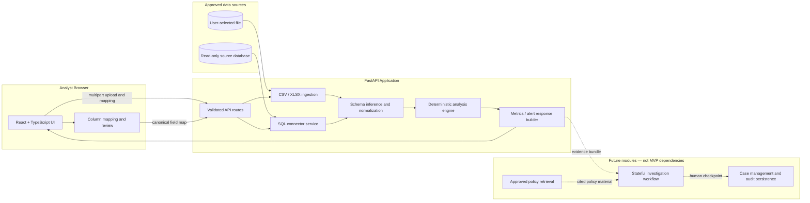

# SentinelAML Architecture

## Logical component diagram



## Suggested repository structure

```text
SentinelAML/
├── README.md
├── docs/
│   ├── PROJECT_BLUEPRINT.md
│   ├── ARCHITECTURE.md
│   ├── ERD.md
│   ├── INGESTION_AND_CONNECTORS.md
│   ├── AML_RULE_CATALOG.md
│   ├── SECURITY.md
│   ├── API_CONTRACT.md
│   └── ROADMAP.md
├── backend/
│   ├── app/
│   │   ├── main.py
│   │   ├── analysis.py
│   │   ├── ingestion.py
│   │   └── sql_sources.py
│   ├── tests/
│   └── requirements.txt
├── frontend/
│   ├── src/
│   ├── index.html
│   └── package.json
└── .github/workflows/
```

## Runtime responsibilities

### Browser
- Handles file selection, source choice, mapping, preview, filters and visualization.
- Does not retain database credentials in localStorage/sessionStorage.
- Sends credentials only over a protected connection to the API. Local HTTP is for local development only.

### API
- Validates size, file type, headers, mappings and requested table identifiers.
- Does not trust filenames, MIME types, data values, or schema metadata.
- Uses bounded reads and a common canonical-analysis interface.
- Never accepts arbitrary SQL strings from the browser.
- Redacts connection strings from logs and exceptions.

### Ingestion adapters
- File adapter supports CSV and Excel; Excel sheet selection should be explicit when a workbook has multiple sheets.
- SQL adapter performs host-policy validation, connection test, reflected table listing, and bounded reads.
- Both adapters produce source metadata, preview schema and a tabular frame.

### Analysis engine
- Validates required mappings; normalizes timestamp and amount data.
- Computes data quality and non-LLM, deterministic rules.
- Returns a stable JSON response containing KPIs, currency-separated totals, quality checks and evidence-linked alerts.

## Runtime versus persisted data

Initial file and SQL analysis is request-scoped. The MVP should not persist raw transaction rows or SQL credentials. Later case management may persist minimized evidence references and analysis metadata under explicit retention rules. Full bank-data persistence requires a separate threat model, authorization controls, encryption, tenant isolation and audit review.

## Agent extension boundary

Future agent orchestration may call only typed, allowlisted tools, such as:
- `get_alert_evidence(alert_id)`
- `get_account_activity(account_id, date_range, limit)`
- `calculate_transaction_statistics(account_id, date_range)`
- `search_approved_policy(query)`
- `draft_case_summary(evidence_ids)`

The agent must not call arbitrary SQL, alter source records, decide guilt, freeze accounts, or submit regulatory filings. Approval is a visible workflow checkpoint, not an LLM prompt alone.
