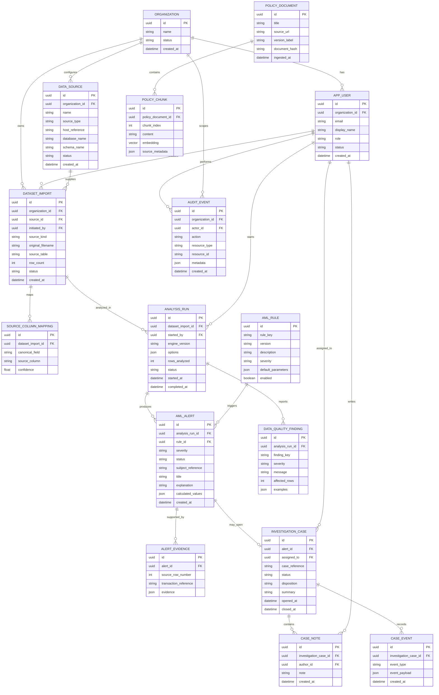

# SentinelAML Entity Relationship Diagram (ERD)

The following ERD is the **target persistent model** for case-management phases. The first file-analysis MVP may return results in memory and therefore does not require every table to exist yet. Do not store raw source credentials in this schema.

## Entity notes and constraints

- `organization_id` belongs on every tenant-owned record; production queries must scope by the authenticated tenant.
- Database passwords, full secret-bearing connection URLs, access tokens, and raw private keys must never be persisted in `DATA_SOURCE`.
- `host_reference` should identify an administrator-approved host entry, not be a free-form secret connection string.
- Evidence should be minimized and protected. Prefer stable source-row references plus selected fields rather than copying complete financial records into every alert.
- Store each analysis rule's version and parameters with the run so reviewers can reproduce why an alert was generated.
- Use foreign keys, indexes on time/status/organization, unique constraints for rule keys and source mappings, and soft-delete/retention policy where appropriate.
- The `vector` type in the diagram is conceptual; implementation may use pgvector or a separate approved retrieval service.
