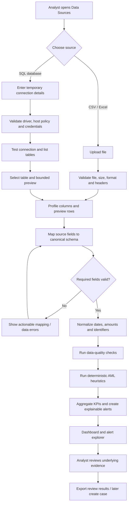
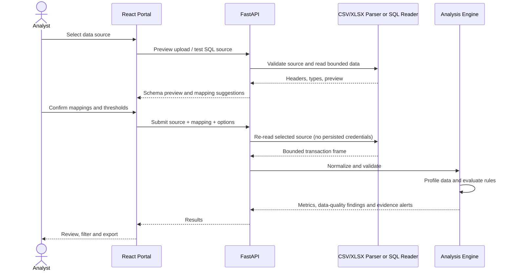

# SentinelAML — Product Blueprint

## 1. Vision

SentinelAML is an analyst-assistance workbench for transaction-data profiling, explainable AML risk-indicator detection, and evidence-backed case preparation. The first milestone is deliberately data-source-first: analysts can upload CSV/Excel data or connect to a permitted SQL data source, map transaction columns, validate the data, and run the same analysis pipeline.

**Design principle:** deterministic, reproducible analysis finds and explains patterns; AI later helps investigators navigate evidence and approved policy documents. The system must not treat an alert as proof of wrongdoing.

## 2. MVP outcomes

1. Upload CSV, XLSX, or XLS data with file size and row-count limits.
2. Preview records and columns before analysis.
3. Map source columns to canonical transaction fields, with suggestions based on column names and data types.
4. Run data-quality checks and transaction-level analysis.
5. Show portfolio KPIs, alert counts by severity/rule, evidence rows, and downloadable review results.
6. Test a SQL connection, list tables, preview a bounded sample, map fields, and analyze using the same engine.
7. Never save source database credentials or expose them back to the browser after a request.
8. Maintain clear disclaimers, source references, and human review for consequential decisions.

## 3. Actors and permissions

| Actor | MVP responsibility | Later capability |
| --- | --- | --- |
| Compliance analyst | Upload/import data, review metrics and alerts | Create and document cases |
| Investigator | Inspect evidence, linked transactions, add notes | Multi-step AI-assisted investigations |
| Compliance supervisor | Review escalations and reports | Approve/return cases |
| Platform administrator | Configure approved database hosts and app settings | Tenant, user, policy and retention administration |
| Auditor | Read approved case and activity records | Export evidence/audit trail |

The starter MVP is a local development prototype. Authentication, tenant isolation, and production-grade authorization must be implemented and independently reviewed before institutional use.

## 4. End-to-end product flow

## 5. Analysis lifecycle

## 6. Canonical transaction model

Required mapping:
- `timestamp`: transaction date/time
- `amount`: numeric transaction amount (negative values may represent reversals/outflows; interpretation should be configured)
- `source_account`: originator/debit account identifier

Optional mapping:
- `transaction_id`
- `destination_account`
- `customer_id`
- `currency`
- `transaction_type`
- `channel`
- `status`
- `country`
- `balance_after`

Preserve source row number for evidence. Keep identifiers as strings (not floating-point values) to protect leading zeros. Do not aggregate money across currencies; report amounts by currency unless the analyst filters to one currency or supplies a valid FX conversion dataset.

## 7. First analysis outputs

- Volume: row count, valid rows, date range and data-source details.
- Amounts: total and average by currency, median, maximum and distributions.
- Coverage: distinct source accounts, destination accounts and customers when mapped.
- Quality: missing required fields, invalid timestamps/amounts, duplicate transaction IDs, negative/zero amounts and parse failures.
- Alerts: rule ID/version, severity, reason, calculation, evidence row references, relevant values, and caveats.
- All alert classifications mean “review suggested”; they are not determinations of criminality.

## 8. MVP detection catalogue

Initial configurable heuristics:
1. High-value transaction above a user-configured amount threshold.
2. Transaction velocity: account-level transaction count within a configurable time window.
3. Possible structuring: repeated amounts near a configured reference threshold in a time window.
4. Robust account-level amount outlier using median and median absolute deviation (MAD), where the account has enough observations.
5. Data-integrity signals such as duplicate transaction IDs or invalid critical fields.

Thresholds are demonstrative defaults and must not be represented as SBP-mandated thresholds. Rules should be configurable, versioned, tested, and calibrated to a specific institution and product before use.

## 9. SQL source design

- Supported drivers are explicitly allowlisted. Initial target: PostgreSQL, MySQL/MariaDB, and SQLite within an approved local path.
- Connection details are submitted at request time only and are not persisted in application data, settings, logs, or browser storage.
- Production deployments must use a network egress allowlist and approved secret-handling strategy; connections to arbitrary hosts must be blocked.
- SQL account must be read-only and scoped to approved schema/table access.
- The MVP offers connection test, table discovery, column discovery, preview, and bounded table import. It does **not** provide arbitrary SQL execution.
- Apply statement timeout where supported, row limits, connection timeout, TLS requirements, and host validation.
- Never use SQL-provided values to build unquoted SQL strings; use SQLAlchemy reflection and parameterized APIs.

## 10. Non-functional requirements

- Explainability: every alert links to the exact rows and calculation behind it.
- Reproducibility: record rule ID/version and analysis options with exported results.
- Safe defaults: input size/row limits, no automatic account actions, no hidden uploads to an LLM.
- Privacy: process only authorized data, minimize retained data, avoid sensitive payloads in logs.
- Accessibility: keyboard-friendly controls, readable contrast, responsive layouts, plain-language error messages.
- Quality: unit tests for parsing, normalization, rules, SQL host policy and export; CI runs tests and type/lint checks.
- Resilience: invalid rows are reported rather than silently dropped; large jobs should later move to a background worker.

## 11. Out of scope for initial MVP

- Automatically blocking/freezing accounts or initiating transactions.
- Automatically filing STR/SAR reports.
- Autonomous customer risk decisions or blacklisting.
- Production integration with a bank core or payment network.
- Claims of regulatory certification, real-time monitoring, or proven fraud prevention.
- Sending real customer data to external AI APIs without explicit institutional approval.

## 12. MVP acceptance criteria

- User can preview a valid CSV or Excel workbook within configured limits.
- UI supports required field mapping and identifies missing mappings before analysis.
- Same valid dataset and options produce repeatable metrics and alerts.
- Alerts include rule, reason, severity, evidence row numbers, and limitations.
- User can test an approved SQL connection and inspect a capped preview without entering arbitrary SQL.
- Connection credentials are not stored, logged, included in frontend source, or returned in responses.
- Malformed, oversized, unsupported, and empty inputs return clear errors.
- Automated tests exercise core rules, mapping, file validation and SQL safety checks.
